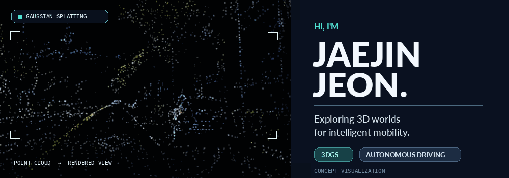

  
    
  <h3><i>Por probar, nada se pierde.</i></h3>
  
<i>시도 해본다고 잃을 건 없다.</i>

  

    
    
  

👋 About Me
I'm a master's student interested in 3D scene understanding and intelligent autonomous systems. My research explores how 3D scene representations, perception, and learning-based driving can help machines understand and navigate the world.
- 🎯 Research: 3D Gaussian Splatting · NeRF · LiDAR Perception · Vision-Language Models
- 🚗 Applications: Autonomous Driving · Closed-Loop Simulation · Safety-Critical Scenarios
- 🧠 Focus: Bridging photorealistic 3D reconstruction and robust decision-making
🔬 Research Interests

  
  
  
  
  

📚 Selected Research
Project	Description	Status
CoSI-Drive	Self-improving end-to-end driving through 3DGS-based counterfactual scenario generation	Research in progress
RoboLoc	A benchmark dataset for point place recognition and localization in indoor-outdoor integrated environments	IET Image Processing

🛠️ Languages & Tools
Programming

  
  
  
  
  
  

Research & Development

  
  
  
  
  
  

📊 GitHub Stats

  

  Banner: AI-generated visualization of a splat-to-image transition, not a rendering from an actual 3DGS experiment.

